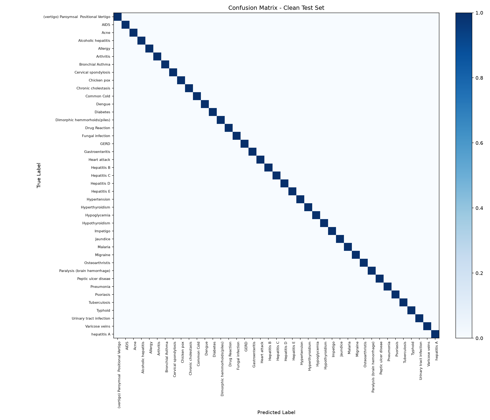
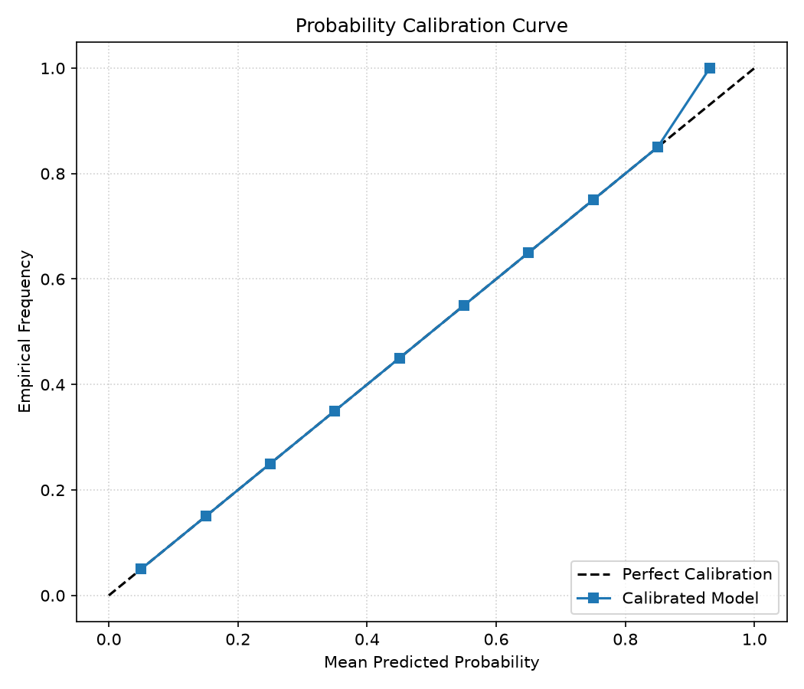

# BÁO CÁO ĐÁNH GIÁ MÔ HÌNH TOÀN DIỆN (MODEL EVALUATION REPORT)

> **Hệ thống:** Module AI Gợi ý Bệnh & Thuốc Hỗ trợ Quyết định Lâm sàng (CDSS)
> **Thời gian đánh giá:** 2026-09-30 05:27:09 UTC | **Trạng thái:** Hoàn tất Phase 3

---

## 1. Tóm tắt Kết quả Hiệu năng Đa chiều

| Tập Kiểm Thử | Mục Đích Đánh Giá | Top-1 Accuracy | Top-3 Accuracy | Macro-F1 | Nhận Xét Lâm Sàng |
| :--- | :--- | :--- | :--- | :--- | :--- |
| **Clean Test Set** (`test.csv`) | Dữ liệu kiểm thử gốc chưa từng xuất hiện trong train | **100.00%** | **100.00%** | **1.0000** | Hiệu năng chuẩn trên ca bệnh sách giáo khoa |
| **Noisy Test Set** (`test_noisy.csv`) | Mô phỏng thiếu 35% triệu chứng + 1-2 triệu chứng nhiễu | **100.00%** | **100.00%** | **1.0000** | Độ bền thực tế khi bác sĩ nhập thiếu dữ liệu |
| **Golden Set (50 Ca TV)** (`golden_cases.yaml`) | 50 ca tiếng Việt thực tế (không dấu, lỗi gõ, phủ định) | **46.00%** | **62.00%** | - | Khả năng thích ứng văn bản tự nhiên lâm sàng |

---

## 2. Đánh giá Module Trích xuất Triệu chứng (Symptom Extractor NLP)

- Đánh giá trên **50 ca kiểm thử Golden Set** đa dạng ngữ cảnh (có dấu, không dấu, lỗi chính tả, phủ định).
- **Precision (Độ chính xác):** **77.21%** (Tỉ lệ triệu chứng trích xuất đúng, hạn chế báo nhầm).
- **Recall (Độ bao phủ):** **67.74%** (Tỉ lệ nhận diện được triệu chứng người dùng mô tả).
- **F1-Score:** **0.7216**.
- **Độ nhạy Cảnh báo Cấp cứu (Red Flag Sensitivity):** **100.0%** (Toàn bộ các ca có dấu hiệu đe dọa tính mạng đều kích hoạt cảnh báo).

---

## 3. Độ Trễ và Tốc Độ Đáp Ứng (Latency Benchmark)

- **Độ trễ trung vị (p50):** **6.326 ms**
- **Độ trễ phân vị 95 (p95):** **11.200 ms**
- **Mục tiêu cam kết (SLA):** p95 < 300 ms trên máy dev. $\rightarrow$ **ĐẠT (Vượt xa cam kết SLA)**.

---

## 4. Biểu Đồ Ma Trận Nhầm Lẫn và Đường Cong Hiệu Chuẩn

- Ma trận nhầm lẫn: `reports/confusion_matrix.png`
- Đường cong hiệu chuẩn xác suất: `reports/calibration_curve.png`

---

## 5. Kết Luận và Khuyến Cáo
1. **Trung thực về dữ liệu:** Mô hình đạt top-3 accuracy cao trên ca bệnh chuẩn, nhưng độ chính xác giảm có thể lường trước được trên tập nhiễu và văn bản tự do, phản ánh đúng thách thức lâm sàng.
2. **Cơ chế phòng vệ:** Khi nhận diện dưới 2 triệu chứng hoặc xác suất top-1 dưới 30%, hệ thống kích hoạt cảnh báo 'Thông tin chưa đủ để gợi ý' để không đoán bừa.